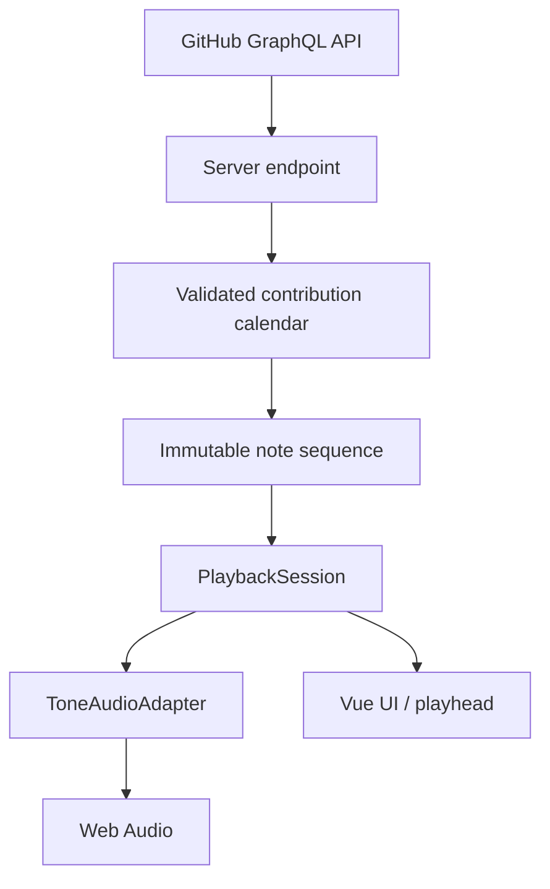

# GitGroove

**GitHub Contribution Grid × interactive music studio**

GitGroove makes a GitHub profile's contribution history audible. A calendar of daily activity becomes bass, chords and melody. Select a section of the grid, start playback, then shape the tempo and sound directly in your browser.

The project combines data visualization, musical mapping and real-time audio in a Vue/TypeScript application. Built by [CodeRacon](https://github.com/CodeRacon) as a playable sound sculpture and a project for the [developer portfolio](https://www.michael-buschmann.dev).


_Studio view with a synthetic test calendar. The contribution counts shown are not actual activity data from CodeRacon's profile._

## Try it

1. Enter a public GitHub username or select **Try CodeRacon**. You do not need a GitHub account of your own.
2. Choose **4 / 8 / 12 / 16** weeks with the section-length buttons, or use **More…** for other lengths. Move the selection bracket to the weeks you want to hear.
3. Press **Play**. The selected section repeats while the playhead tracks its position in the calendar.
4. Set the tempo between **30 and 300 BPM** and shape Bass, Pad and Lead with their sound controls, volume, Mute and Solo. The root-key keyboard transposes all voices; each synth also has its own octave control.
5. **Share sound** creates a complete sound link and QR code. **Download WAV** saves the selected section as an audio file.

Pause keeps the current position; Stop returns to the section start. Playback continues when you move between Studio, Glossary, About and the legal pages. A paused sequence stays paused. Selecting a different section stops playback. **Key, octave and arpeggio-pattern changes keep the loop running:** new notes follow the updated settings while existing notes and effects can ring out. Changes made while paused preserve the paused position. **Reset sound** restores the original sound, mix and tempo while keeping the calendar and selected section.

On smaller screens, the calendar scrolls horizontally. The selection bracket and rotary controls support mouse, touch and keyboard input. Loading failures, missing calendars and sections without contributions have explanatory feedback.

## Playback throughout the app

**Space · Play/Pause** controls the current sequence from every view. Pause keeps the position; Play resumes from there. Space retains its normal behavior in text fields, dropdowns, focused buttons, links, other activatable controls and open dialogs. Custom rotary controls can use the shortcut. Holding the key toggles playback only once. Playback cannot start without a loaded calendar or while data or audio is starting.

A **mini player** appears at the bottom when the main playback controls are not fully visible. It shows the profile, section length, playback state and Play/Pause. It stays available after pausing and on the information pages. Selecting its profile returns to the studio controls. Both players use the same playback session. Reserved space and safe-area padding keep content and controls accessible on desktop and mobile. Internal navigation preserves a shared sound's URL fragment so changing views does not reload its snapshot.

Common section lengths have dedicated buttons. **More…** offers additional lengths, shorter sections and the full calendar. Custom lengths restored from shared sounds remain visible. Length and bracket changes stop playback at the section start.

## Technology

| Technology                        | Role                                                                |
| --------------------------------- | ------------------------------------------------------------------- |
| Vue 3 with Composition API        | Components, reactive UI and interactive controls                    |
| TypeScript                        | Typed contribution data, note events, playback and synth interfaces |
| Pinia                             | Contribution-calendar data and loading/error state                  |
| Vue Router                        | Studio, glossary, project information and legal views               |
| Tone.js / Web Audio               | Synthesis, effects and scheduled playback                           |
| Vite                              | Development server, production build and local GitHub proxy         |
| PHP / GitHub GraphQL API          | Server-side contribution requests in production                     |
| Vitest / Vue Test Utils / Cypress | Domain, component and end-to-end tests                              |

## Architecture and data flow



The browser requests `/api/contributions.php` on the same origin. A Vite plugin handles the endpoint during development; PHP handles it in production. Both call the GitHub GraphQL API and keep the token on the server.

| Module                                                                                                        | Responsibility                                                                            |
| ------------------------------------------------------------------------------------------------------------- | ----------------------------------------------------------------------------------------- |
| [`src/services/github`](src/services/github/github.service.ts) and [`src/stores`](src/stores/github.store.ts) | HTTP requests, useful errors and protection against stale responses after profile changes |
| [`src/contributions/calendar.ts`](src/contributions/calendar.ts)                                              | Validation, sorting and normalization into seven day steps per week                       |
| [`src/music/score.ts`](src/music/score.ts)                                                                    | Reproducible mapping from calendar and selection to typed note events                     |
| [`src/playback/session.ts`](src/playback/session.ts)                                                          | State, tempo, position, Play, Pause and Stop through a `PlaybackAdapter` interface        |
| [`src/playback/tone-adapter.ts`](src/playback/tone-adapter.ts)                                                | Tone.js transport and note-event execution                                                |
| [`src/audio/graph.ts`](src/audio/graph.ts)                                                                    | Shared synth and effect graph for live playback and offline export                        |
| [`src/audio/output.ts`](src/audio/output.ts)                                                                  | Headroom, dynamic compression, a soft output ceiling and stable echo feedback             |
| [`src/audio/export.ts`](src/audio/export.ts) and [`wav.ts`](src/audio/wav.ts)                                 | Isolated offline rendering and PCM WAV encoding                                           |
| [`src/studio`](src/studio)                                                                                    | Central studio state, validated/versioned snapshots and compressed share links            |
| [`src/audio/studio.ts`](src/audio/studio.ts) and [`mix.ts`](src/audio/mix.ts)                                 | UI integration and independent mix logic                                                  |
| [`src/components`](src/components) and [`src/views`](src/views)                                               | Calendar, section selection, transport, synth controls and supporting views               |

### Design decisions

- **Normalize data at the boundary.** Calendar validation checks dates, contribution counts, duplicate days and gaps. Incomplete boundary weeks receive silent placeholders, preserving the grid and timing even across 53 weeks.
- **Separate music generation from audio and UI.** `createScore` produces a sequence typed as `readonly` and frozen at runtime. The profile, calendar snapshot, selection and mapping settings determine the result without runtime randomness. `mappingVersion` identifies the mapping used.
- **Let the audio clock drive timing.** Tone.js schedules notes on its transport. The session reads its position, while `requestAnimationFrame` updates the UI; the render loop never triggers notes. A resolution of 672 ticks per beat gives integer tick positions for seven evenly spaced day steps over four beats.
- **Test playback without audio hardware.** The session depends on an adapter interface. Unit tests replace Tone.js with a controllable fake adapter.
- **Keep the transport running during transposition and pattern changes.** The session checks that a replacement score has the same event times, voices and section boundaries. The adapter then replaces pitches. A shared transport callback reads current note events every 96 ticks, covering all existing subdivisions exactly. It does not create a second sequence, reset the position or cut off effect tails. Section changes load a new section; year changes stop immediately and wait for an explicit Play after loading.
- **Keep mix states independent.** Fader value, Mute, Solo and the playback gate are separate states. Solo can temporarily make a muted voice audible without altering its stored level or Mute state. Short ramps apply level and effect changes.
- **Share the signal graph between playback and export.** Each graph receives an explicit audio context. Export uses its own `Tone.OfflineContext`, leaving the live context and transport running. QR generation and export code load on demand.
- **Give audio instances a defined lifecycle.** During hot module replacement, the studio disposes its watchers, transport and audio graph so old synth and effect instances cannot keep running alongside new ones.
- **Make share links self-contained.** A compact, versioned snapshot stores the calendar, boundary placeholders and every studio setting. Native `CompressionStream`/`DecompressionStream` APIs and Base64url encode the state in a URL fragment. Restoration validates versions, data limits, selection boundaries and parameter ranges.

The domain terminology and relationships are also documented in [`CONTEXT.md`](CONTEXT.md).

## Contribution history

Below the grid, **Last 12 months** sits alongside the contribution years reported by GitHub, newest first. The rolling year is the initial view. Calendar years run from January 1 to December 31, or through today for the current year. UTC boundaries, leap years and incomplete boundary weeks are handled explicitly. The year buttons scroll horizontally on narrow screens.

Both proxies request `contributionYears` and accept a validated optional `year` parameter. Calendar-year queries use explicit `from` and `to` values. The browser's in-memory cache separates profiles and periods, reuses successful responses for five minutes and holds at most 40 entries. The production endpoint does not persist calendar responses in files. The local development proxy also uses an in-memory cache. Years load on demand, subject to GitHub's contribution visibility settings and API permissions.

Changing years preserves sound, tempo and the selected length and position where they fit the new calendar. The previous calendar stays available while loading and after errors. Choosing another year stops playback immediately. Once loaded, the new grid waits for Play, which starts from the selected section's beginning. Late responses from superseded requests cannot replace the current selection. Selecting the already active period leaves playback unchanged and can cancel a pending switch. Shared sounds restore their frozen calendars without a contribution request; **Explore profile history** explicitly returns to live data.

## From calendar to music

One calendar week becomes a **4/4 bar with seven evenly spaced day steps**, each `4 / 7` beats apart. With the default Original pattern, daily contribution counts determine which voices play:

| Daily contributions                              | Musical result                        |
| ------------------------------------------------ | ------------------------------------- |
| 0, or a placeholder outside the requested period | No new note events                    |
| 1–5                                              | Bass root note                        |
| 6–10                                             | Bass and a pad chord                  |
| 11–19                                            | An additional two-note lead phrase    |
| 20 or more                                       | An additional four-note lead arpeggio |

Contribution intensity also affects velocity. Week position and contribution counts select a chord from `I`, `IV`, `V` and `vi`. A hash of the profile name, date and contribution count determines the lead-note order. C major is the default. The root-key keyboard offers twelve major keys, and each voice has an octave range of −1 to +1. Original preserves the C-major voicings of mapping version 2 and transposes them by the selected key and octave. Mapping version 3 adds the selectable patterns below.

Bass and Lead independently offer **Original**, **Up**, **Down** and **Up/Down**. Original reproduces the earlier mapping, including its data-driven lead phrases. The other patterns move through the weekly chord's three tones in ascending or descending registers. Up/Down uses indices `0, 1, 2, 1`, without repeating turning notes. Patterns restart each source week, independently of the selected section. Bass keeps one note per active day; Lead keeps its two or four notes. Patterns change pitches, preserving event times, note counts and silent days. Key and octave transposition apply afterward. Reset sound restores Original for both voices.

Each voice has a different signal path:

- **Bass:** MonoSynth with Square, Sine, Triangle or Saw waveform, a low-pass filter and adjustable resonance.
- **Pad:** PolySynth with FMSynth voices, low-pass filtering, chorus and reverb, with separate amplitude and modulation envelopes.
- **Lead:** MonoSynth with low-pass filtering, ping-pong delay, distortion and reverb.

Tempo and synth controls change playback and timbre while the calendar remains the basis of the note sequence. Silent days start no new notes; existing notes and effects can ring out.

**Lead focus** briefly lowers the pad at lead-note attacks: 12 ms attack, 180 ms return and up to 12 dB attenuation at 100%. It respects Mute, Solo and the playback gate. At 0%, attenuation is disabled. Stored fader values remain unchanged.

After effects, levels and Mute/Solo, all three voices pass through a **shared output stage**. It provides 6 dB of headroom, a compressor with 3 ms attack and 120 ms release, and a soft ceiling below ±0.98. This controls combined peaks before they reach the browser output or WAV encoder. Fader values remain unchanged, but the overall output is quieter than the earlier unprotected signal path and can compress at high levels. The added headroom does not normalize loudness between profiles.

The feedback control's 0–1 range maps internally to 0–95% regeneration. Even its maximum setting gradually decays. Waveforms, notes and intentionally enabled distortion retain their character. Live playback and export use the same output processing and feedback curve.

## Sharing sounds and exporting audio

A snapshot includes the **profile name, frozen contribution calendar, section length and bracket position, BPM, key, all three octaves, both arpeggio patterns, selected calendar year, every synth control and effect, volume, Mute/Solo, Lead focus and the selected pad-envelope view**. Later GitHub activity cannot change the captured calendar. Recipients restore the sound without another contribution request and explicitly press Play to listen. They can subsequently load current profile data.

Links are created entirely in the browser, without a snapshot storage service. The QR code contains the same link and can be downloaded as PNG. The small `qrcode` library loads on demand. Sharing and restoration require the browser's native compression APIs. A snapshot too large for a QR code remains available as a copyable link.

Snapshots version their data format, musical mapping and sound graph. Unsupported versions produce a useful error. Note sequences and settings restore exactly; audio samples may differ because reverb impulse responses are generated for each audio context. WAV export provides a fixed audio recording.

Sound graph version 2 adds output protection and the stable feedback curve. Version-1 links remain supported: their calendar, notes and control settings are preserved, while playback uses the corrected processing. New links save version 2. Mapping version 3 adds selectable arpeggio patterns; mapping-version-2 links restore Original for both voices and retain their earlier note sequence.

**Download WAV** freezes the state at the start of the export and renders stereo PCM at **44.1 kHz / 16 bit**, including effects and the current mix:

- **Loop:** exactly one selected section. A twelve-second preroll establishes envelopes and effects, after which the result is trimmed to the exact frame count. Short 3 ms fades at both boundaries avoid discontinuities when repeating.
- **Clip with effect tail:** one section from its beginning, followed by twelve seconds of decay and a final fade.

The dialog shows duration, estimated file size and progress. Peaks exceeding the PCM maximum are reduced to 98% to prevent export clipping; this adjustment is reported. Cancel discards the result. An already running native offline render finishes internally before its resources are released. MP3 encoding is not included.

## Local development

Requirements: Node.js and npm. Development and verification used Node.js 24. Loading actual contributions also requires a GitHub token that can execute the GraphQL query.

```bash
git clone https://github.com/CodeRacon/GitGroove.git
cd GitGroove
npm ci
```

Create a `.env` file in the project root:

```dotenv
GITHUB_TOKEN=your_github_token
```

```bash
npm run dev
```

Open the local URL printed by Vite. The development proxy handles API requests, so a local PHP server is not needed. Restart the development server after changing `.env`.

`.env` is excluded from version control. The token is named `GITHUB_TOKEN`, **without a `VITE_` prefix**, and is read by the server plugin. Never put actual tokens in client code or the repository.

## Testing and quality checks

```bash
npm run type-check
npm run lint
npm run test:unit -- --run
npm run build
npm run test:e2e
npm run test:audio
```

`npm run build` runs typechecking and creates the production build. End-to-end tests require this build; the E2E script starts the preview server and Cypress. UI scenarios intercept the GitHub endpoint with fixed test data and do not need a token.

`npm run test:audio` requires Google Chrome and starts a separate local Vite server on port 4175. Its test harness renders the actual synth and effect graph through Web Audio without requesting GitHub data. It checks samples for overload, audible output, feedback decay and waveform/octave transitions. A transport test also stops the real Tone.js transport for a calendar change and compares note counts, pitches and timing before the stop and after an explicit restart. No new notes may begin during the loading pause. Test fixtures are not included in the production build.

Tests cover the application's main boundaries:

- **Calendar:** incomplete weeks, 53-week calendars and invalid data.
- **Mapping:** reproducible events, immutable snapshots, day steps and chords.
- **Playback and mix:** tempo, pause/resume, key/octave changes during playback and while paused, plus interactions between Solo, Mute and fader values. Adapter tests verify that existing callbacks use new pitches without interrupting transport or effect tails.
- **Controls:** native sliders, keyboard input, selection boundaries, pointer gestures and cancellation.
- **User flows:** profile loading, the example profile, failed profile changes, section selection, playback across views and explanations for silent sections.
- **Snapshots:** complete parameter/calendar round trips, independent copies, version/range validation and protection against malformed or oversized links and late profile responses.
- **Audio export:** WAV headers, stereo interleaving, exact frame counts, boundary fades, peak normalization and cancellation. Cypress checks downloaded WAV data and uninterrupted live playback.
- **Sound controls and sharing:** transposition, octaves, Lead focus/mix rules and full restoration of a 53-week snapshot without another GitHub request.
- **Legal pages and storage:** reachable provider/privacy information, removal of legacy glossary preferences and preservation of playback and snapshot fragments across navigation.

Cypress also checks desktop, tablet and smartphone layouts and generates screenshots. These tests verify behavior and rendering; listening on physical devices remains a useful additional manual check.

## Build and deployment

```bash
npm run build
```

The build is written to `dist/`. Production hosting must support the included PHP endpoint with cURL.

1. Upload the **contents of `dist/`** to the web root. Vite copies `public/api/contributions.php` to `dist/api/contributions.php`.
2. Configure `GITHUB_TOKEN` in the server environment. On hosting with a `public_html` directory, you can instead copy [`deployment/gitgroove-secret.example.php`](deployment/gitgroove-secret.example.php) to `gitgroove-secret.php` above `public_html` and set the token there.
3. Check `/api/contributions.php?username=CodeRacon` on the host, then test profile loading and playback in the browser.

The production endpoint processes calendar responses only for the duration of each request. It removes calendar-cache files created by earlier releases from the temporary server directory on the next API request; server permissions must allow deletion. The browser and local development proxy reuse in-memory responses for five minutes. No new server-side calendar file cache is created. Unknown profiles, authorization failures, rate limits and connection problems return corresponding HTTP errors.

`npm run preview` serves the built frontend. It does not execute PHP or provide the development proxy. Actual profile requests require the development server or correctly configured PHP hosting.

## Provider information and privacy

The footer links **Imprint** (`?view=legal`) and **Privacy** (`?view=privacy`) open dedicated pages from every view. The About view keeps its existing `?view=imprint` URL for compatibility. Navigation preserves shared sound links and live playback.

The privacy policy describes hosting, GitHub requests, data categories, purposes and legal bases, storage, shared snapshots, local WAV rendering, contact and data-subject rights. Glossary preferences are no longer stored persistently; the old `glossaryOpenEntries` entry is removed at startup without reading its contents. The application does not integrate analytics or advertising services.

For your own deployment, update the provider/contact details and privacy policy to match the actual hosting, logging, retention and third-party services in use. Keep API credentials outside the public web root. The included notices do not replace an individual legal assessment.
