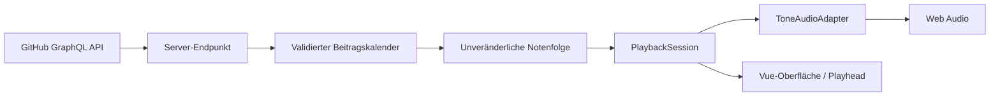

# GitGroove

**GitHub Contribution Grid × interaktives Musikstudio**

GitGroove macht die Beitragshistorie eines GitHub-Profils hörbar. Aus einem Kalender voller täglicher Aktivität entstehen Bass, Akkorde und Melodie. Du wählst einen Abschnitt im Raster, startest die Wiedergabe und veränderst Tempo und Klang direkt im Browser.

Das Projekt verbindet Datenvisualisierung, musikalisches Mapping und Echtzeit-Audio in einer Vue-/TypeScript-Anwendung. Entwickelt von [CodeRacon](https://github.com/CodeRacon) als spielbare Klangskulptur und als Projekt für das [Entwickler-Portfolio](https://www.michael-buschmann.dev).


_Studio-Ansicht mit synthetischem Testkalender. Die dargestellten Beitragszahlen sind keine echten Profildaten von CodeRacon._

## Ausprobieren

1. Einen öffentlichen GitHub-Benutzernamen eingeben oder **Try CodeRacon** anklicken. Ein eigener GitHub-Account ist dafür nicht erforderlich.
2. Die Abschnittslänge wählen und den Auswahlbügel auf die gewünschten Wochen verschieben.
3. **Play** drücken. Der Abschnitt wiederholt sich, während der Playhead die aktuelle Position im Kalender zeigt.
4. Das Tempo zwischen **30 und 300 BPM** ändern und Bass, Pad und Lead über Lautstärke, Klangregler, Mute und Solo gestalten.

Pause hält die aktuelle Position; Stop setzt die Wiedergabe an den Abschnittsanfang zurück. Beim Wechsel ins Glossar oder zur Projektbeschreibung pausiert die Musik. Ein neuer Abschnitt erzeugt eine neue Sequenz und stoppt die bisherige Wiedergabe.

Das Raster lässt sich auf kleinen Bildschirmen horizontal scrollen. Auswahlbügel und Drehregler unterstützen Maus, Touch und Tastatur; die Oberfläche erklärt Ladefehler, fehlende Kalenderdaten und Abschnitte ohne Beiträge.

## Technischer Überblick

| Technologie                       | Aufgabe                                                                       |
| --------------------------------- | ----------------------------------------------------------------------------- |
| Vue 3 mit Composition API         | Komponenten, reaktive Oberfläche und interaktive Controls                     |
| TypeScript                        | Typisierte Beitragsdaten, Notenereignisse, Playback- und Synth-Schnittstellen |
| Pinia                             | Laden und Zustand des GitHub-Beitragskalenders                                |
| Vue Router                        | Studio, Glossar und Projektbeschreibung                                       |
| Tone.js / Web Audio               | Synthese, Effekte und zeitlich geplante Wiedergabe                            |
| Vite                              | Entwicklung, Produktionsbuild und lokaler GitHub-Proxy                        |
| PHP / GitHub GraphQL API          | Serverseitiger Datenabruf im Deployment                                       |
| Vitest / Vue Test Utils / Cypress | Domänen-, Komponenten- und End-to-End-Tests                                   |

## Architektur und Datenfluss



Der Browser fragt den gleichnamigen Endpunkt `/api/contributions.php` an. In der Entwicklung beantwortet ihn ein Vite-Plugin, im Deployment eine PHP-Datei. Beide greifen auf die GitHub GraphQL API zu und halten den Token auf der Serverseite.

| Modul                                                                                                         | Verantwortung                                                                            |
| ------------------------------------------------------------------------------------------------------------- | ---------------------------------------------------------------------------------------- |
| [`src/services/github`](src/services/github/github.service.ts) und [`src/stores`](src/stores/github.store.ts) | HTTP-Abruf, verständliche Fehler und Schutz vor verspäteten Antworten bei Profilwechseln |
| [`src/contributions/calendar.ts`](src/contributions/calendar.ts)                                              | Validierung, Sortierung und Normalisierung auf sieben Tage je Woche                      |
| [`src/music/score.ts`](src/music/score.ts)                                                                    | Reproduzierbares Mapping von Kalender und Auswahl auf typisierte Notenereignisse         |
| [`src/playback/session.ts`](src/playback/session.ts)                                                          | Status, Tempo, Position sowie Start, Pause und Stop über ein `PlaybackAdapter`-Interface |
| [`src/playback/tone-adapter.ts`](src/playback/tone-adapter.ts)                                                | Tone.js-Transport, Audio-Signalwege und Ausführung der Notenereignisse                   |
| [`src/audio`](src/audio)                                                                                      | Synth-Parameter, unabhängige Mix-Logik und Verbindung zur Oberfläche                     |
| [`src/components`](src/components) und [`src/views`](src/views)                                               | Kalender, Bereichsauswahl, Transport, Synth-Controls und ergänzende Ansichten            |

### Entscheidungen hinter der Implementierung

- **Daten werden am Eingang normalisiert.** Der Kalender prüft Datumswerte, Beitragszahlen, doppelte Tage und Lücken. Unvollständige Randwochen erhalten stumme Platzhalter. Dadurch bleiben Zeitstruktur und Raster auch bei 53 Wochen konsistent.
- **Musikgenerierung ist von Audio und UI getrennt.** `createScore` erzeugt eine mit `readonly` typisierte und zur Laufzeit eingefrorene Notenfolge. Profil, Kalender-Schnappschuss, Auswahl und Mapping-Einstellungen bestimmen das Ergebnis; Zufall zur Laufzeit wird nicht benötigt. `mappingVersion` kennzeichnet die verwendete Mapping-Version.
- **Die Audio-Uhr bestimmt das Timing.** Tone.js plant Noten über seinen Transport. Die Session liest dessen Position aus; `requestAnimationFrame` aktualisiert die Darstellung. Die Render-Schleife löst keine Noten aus. Eine Auflösung von 672 Ticks pro Beat erlaubt ganzzahlige Tick-Positionen für die sieben gleichmäßigen Tagesschritte innerhalb von vier Beats.
- **Playback lässt sich ohne Audio-Gerät testen.** Die Session arbeitet gegen ein Adapter-Interface; Unit-Tests ersetzen Tone.js durch einen kontrollierbaren Fake-Adapter.
- **Mix-Zustände bleiben getrennt.** Faderwert, Mute, Solo und Wiedergabe-Gate sind eigene Zustände. Solo kann eine gemutete Stimme vorübergehend hörbar machen, ohne deren gespeicherten Pegel oder Mute-Zustand zu verändern. Pegel- und Effektänderungen werden im Audio-Adapter über kurze Rampen angewendet.

Die Begriffe und ihre Beziehungen sind zusätzlich in [`CONTEXT.md`](CONTEXT.md) dokumentiert.

## Vom Kalender zur Musik

Eine Kalenderwoche entspricht einem **4/4-Takt mit sieben gleichmäßig verteilten Tagesschritten**. Die Schritte liegen jeweils `4 / 7` Beats auseinander. Die Anzahl der Beiträge bestimmt, welche Stimmen einsetzen:

| Beiträge an einem Tag                      | Musikalisches Ergebnis                            |
| ------------------------------------------ | ------------------------------------------------- |
| 0 oder Platzhalter außerhalb des Zeitraums | Keine neuen Notenereignisse                       |
| 1–5                                        | Bass-Grundton                                     |
| 6–10                                       | Bass und Pad-Akkord                               |
| 11–19                                      | Zusätzlich eine Lead-Folge aus zwei Akkordtönen   |
| 20 und mehr                                | Zusätzlich ein Lead-Arpeggio aus vier Akkordtönen |

Die Beitragsstärke beeinflusst auch die Anschlagstärke. Wochenposition und Beitragsmenge bestimmen den Akkord aus `I`, `IV`, `V` und `vi`. Ein Hash aus Profilname, Datum und Beitragszahl legt die Reihenfolge der Lead-Töne fest. Das aktuelle UI verwendet das Standard-Mapping in C-Dur.

Die drei Signalwege sind unterschiedlich aufgebaut:

- **Bass:** MonoSynth mit Tiefpassfilter und einstellbarer Resonanz.
- **Pad:** PolySynth mit FMSynth-Stimmen, Tiefpass, Chorus und Reverb; separate normale und Modulationshüllkurve.
- **Lead:** MonoSynth mit Tiefpass, Ping-Pong-Delay, Distortion und Reverb.

Tempo und Synth-Regler verändern die Wiedergabe und den Klang. Das Kalender-Mapping bleibt dabei die Grundlage der Notenfolge. Tage ohne Beiträge erzeugen keine neuen Töne; bereits gestartete Töne und Effekte können ausklingen.

## Lokal starten

Voraussetzungen: Node.js und npm; die Entwicklung und Prüfungen wurden mit Node.js 24 ausgeführt. Für echte Beitragsdaten wird außerdem ein GitHub-Token benötigt, der die GraphQL-Abfrage ausführen kann.

```bash
git clone https://github.com/CodeRacon/GitGroove.git
cd GitGroove
npm ci
```

Im Projektverzeichnis eine `.env` anlegen:

```dotenv
GITHUB_TOKEN=your_github_token
```

```bash
npm run dev
```

Die von Vite ausgegebene lokale URL öffnen. Der Entwicklungsproxy übernimmt den API-Abruf; lokal wird dafür kein PHP-Server benötigt. Nach einer Änderung an `.env` den Entwicklungsserver neu starten.

`.env` ist vom Repository ausgeschlossen. Der Token heißt ausdrücklich `GITHUB_TOKEN`, **ohne `VITE_`-Präfix**, und wird vom Server-Plugin gelesen. Echte Tokens gehören weder in den Client-Code noch in das Repository.

## Tests und Qualitätssicherung

```bash
npm run type-check
npm run lint
npm run test:unit -- --run
npm run build
npm run test:e2e
```

`npm run build` führt Typechecking und Produktionsbuild aus. Die End-to-End-Tests benötigen diesen Build; das E2E-Skript startet den Preview-Server und Cypress selbst. Die Cypress-Szenarien ersetzen den GitHub-Endpunkt durch feste Testdaten und benötigen daher keinen Token.

Die Tests decken unterschiedliche Grenzen der Anwendung ab:

- **Kalender:** Randwochen, 53 Wochen und ungültige Daten.
- **Mapping:** reproduzierbare Ereignisse, unveränderliche Schnappschüsse, Tagesschritte und Akkorde.
- **Playback und Mix:** Tempo, Pause/Fortsetzen sowie das Zusammenspiel von Solo, Mute und Faderwerten.
- **Controls:** native Slider, Tastaturbedienung, Auswahlgrenzen, Pointer-Gesten und deren Abbruch.
- **User-Flows:** Profil laden, Beispiel-Einstieg, fehlgeschlagener Profilwechsel, Bereichsauswahl, Wiedergabe beim Ansichtswechsel und Hinweise auf stumme Abschnitte.

Cypress prüft zusätzlich das Layout bei Desktop-, Tablet- und Smartphone-Breiten und erstellt Screenshots. Diese Tests prüfen den Ablauf und die Darstellung; ein Hörtest auf realen Geräten bleibt eine ergänzende manuelle Prüfung.

## Build und Deployment

```bash
npm run build
```

Der Build liegt in `dist/`. Für den Live-Betrieb wird ein Hosting benötigt, das den mitgelieferten PHP-Endpunkt mit cURL ausführen kann.

1. Den **Inhalt von `dist/`** in das Webverzeichnis hochladen. Vite kopiert `public/api/contributions.php` nach `dist/api/contributions.php`.
2. `GITHUB_TOKEN` in der Serverumgebung konfigurieren. Alternativ auf einem Hosting mit `public_html` die Datei [`deployment/gitgroove-secret.example.php`](deployment/gitgroove-secret.example.php) als `gitgroove-secret.php` oberhalb von `public_html` ablegen und dort den Token eintragen.
3. Den Endpunkt `/api/contributions.php?username=CodeRacon` auf dem Hosting prüfen und anschließend Profilabruf und Wiedergabe im Browser testen.

Beide Proxy-Implementierungen cachen erfolgreiche Kalenderantworten für fünf Minuten. Fehler bei unbekannten Profilen, fehlender Autorisierung, Rate Limits oder Verbindungsproblemen werden über HTTP-Statuscodes an den Client weitergegeben.

`npm run preview` dient zur Kontrolle des gebauten Frontends. Es führt den PHP-Endpunkt nicht aus und bietet den Entwicklungsproxy nicht an; für einen echten Profilabruf ist daher der Entwicklungsserver oder das konfigurierte PHP-Hosting erforderlich.
