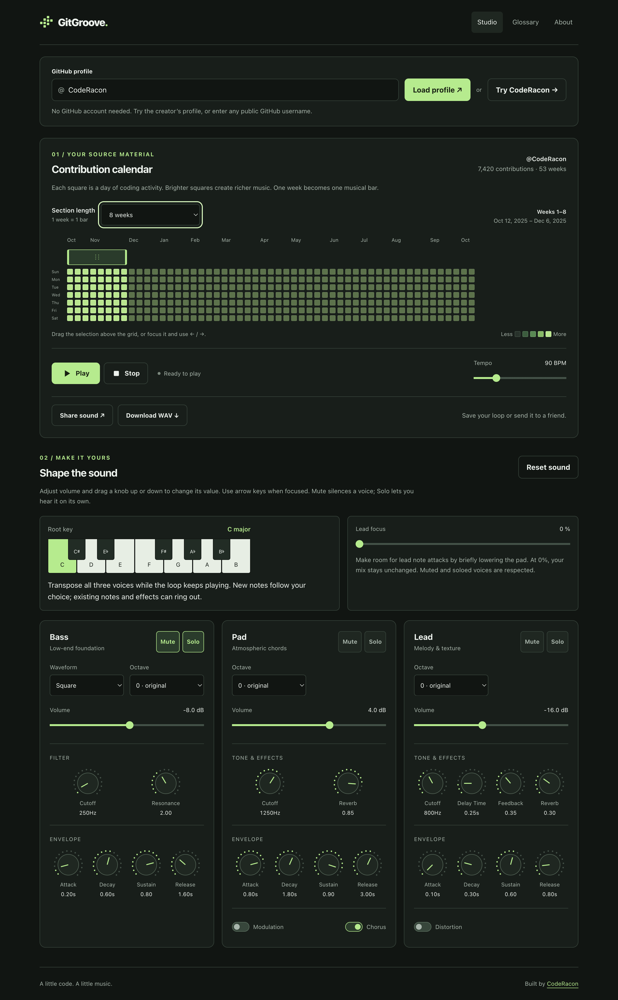
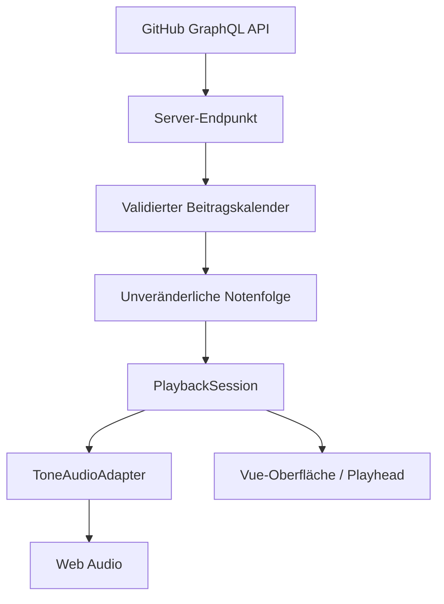

# GitGroove

**GitHub Contribution Grid × interaktives Musikstudio**

GitGroove macht die Beitragshistorie eines GitHub-Profils hörbar. Aus einem Kalender voller täglicher Aktivität entstehen Bass, Akkorde und Melodie. Du wählst einen Abschnitt im Raster, startest die Wiedergabe und veränderst Tempo und Klang direkt im Browser.

Das Projekt verbindet Datenvisualisierung, musikalisches Mapping und Echtzeit-Audio in einer Vue-/TypeScript-Anwendung. Entwickelt von [CodeRacon](https://github.com/CodeRacon) als spielbare Klangskulptur und als Projekt für das [Entwickler-Portfolio](https://www.michael-buschmann.dev).



_Studio-Ansicht mit synthetischem Testkalender. Die dargestellten Beitragszahlen sind keine echten Profildaten von CodeRacon._

## Ausprobieren

1. Einen öffentlichen GitHub-Benutzernamen eingeben oder **Try CodeRacon** anklicken. Ein eigener GitHub-Account ist dafür nicht erforderlich.
2. Die Abschnittslänge über die Schnellwahl **4 / 8 / 12 / 16** oder **More…** wählen und den Auswahlbügel auf die gewünschten Wochen verschieben.
3. **Play** drücken. Der Abschnitt wiederholt sich, während der Playhead die aktuelle Position im Kalender zeigt.
4. Das Tempo zwischen **30 und 300 BPM** ändern und Bass, Pad und Lead über Lautstärke, Klangregler, Mute und Solo gestalten. Die Klaviatur transponiert alle Stimmen; jeder Synth besitzt eine eigene Oktavwahl.
5. **Share sound** erstellt einen vollständigen Sound-Link mit QR-Code. **Download WAV** speichert den ausgewählten Abschnitt als Audiodatei.

Pause hält die aktuelle Position; Stop setzt die Wiedergabe an den Abschnittsanfang zurück. Beim Wechsel zwischen Studio, Glossar und About läuft die Wiedergabe weiter; eine pausierte Sequenz bleibt pausiert. Ein neuer Abschnitt stoppt die bisherige Wiedergabe. **Tonart-, Oktav- und Arpeggio-Pattern-Wechsel laufen ohne Unterbrechung:** Die Abspielposition bleibt erhalten, neue Noten folgen der gewählten Einstellung und bereits klingende Töne und Effekte können ausklingen. Ein pausierter Loop bleibt beim Klangwechsel an seiner Position pausiert. **Reset sound** stellt die ursprünglichen Klang-, Mix- und Tempoeinstellungen wieder her und behält den Kalender und den gewählten Abschnitt.

Das Raster lässt sich auf kleinen Bildschirmen horizontal scrollen. Auswahlbügel und Drehregler unterstützen Maus, Touch und Tastatur; die Oberfläche erklärt Ladefehler, fehlende Kalenderdaten und Abschnitte ohne Beiträge.

## Wiedergabe im gesamten Studio

**Space · Play/Pause** steuert die aktuelle Sequenz aus allen drei Ansichten. Pause behält die Position, Play setzt dort fort. Die Leertaste behält ihre normale Funktion in Eingabefeldern, Dropdowns, auf fokussierten Buttons, Links und anderen aktivierbaren Controls sowie in geöffneten Dialogen. Eigene Drehregler können den Shortcut nutzen; gedrückt gehaltene Tasten toggeln nur einmal. Ohne geladenen Kalender und während Lade-/Audio-Startvorgängen wird kein neuer Start ausgelöst.

Sobald die normale Play-/Pause-Steuerung nicht vollständig sichtbar ist, erscheint unten ein **Mini-Transport** mit Profil, Abschnittslänge, Zustand und Play/Pause. Er bleibt nach dem Pausieren und auf Glossary/About verfügbar. Der Profilbereich führt zur Studio-Steuerung zurück. Auf Desktop und Mobile nutzt er dieselbe Session; reservierter Platz und Safe-Area-Abstände halten Inhalt und Bedienflächen erreichbar. Native Dialoge behalten die Bedienung im Dialog. Interne Navigation erhält auch den Hash eines geteilten Sounds, damit ein Ansichtswechsel den Snapshot nicht erneut lädt.

Die häufigen Abschnittslängen 4, 8, 12 und 16 sind direkte Buttons. **More…** enthält weitere Längen, kurze Abschnitte und Full calendar; wiederhergestellte Sonderlängen bleiben sichtbar. Längen- und Bereichsänderungen stoppen weiterhin am Abschnittsanfang. Ein unterbrechungsfreier Längenwechsel wurde geprüft und bleibt als separate Erweiterung vorgemerkt: Er benötigt eine abgestimmte Übernahme neuer Abschnittsgrenzen und eine klare Darstellung des Übergangs.

## Technischer Überblick

| Technologie                       | Aufgabe                                                                       |
| --------------------------------- | ----------------------------------------------------------------------------- |
| Vue 3 mit Composition API         | Komponenten, reaktive Oberfläche und interaktive Controls                     |
| TypeScript                        | Typisierte Beitragsdaten, Notenereignisse, Playback- und Synth-Schnittstellen |
| Pinia                             | Laden und Zustand des GitHub-Beitragskalenders                                |
| Vue Router                        | Studio, Glossar und Projektbeschreibung                                       |
| Tone.js / Web Audio               | Synthese, Effekte und zeitlich geplante Wiedergabe                            |
| Vite                              | Entwicklung, Produktionsbuild und lokaler GitHub-Proxy                        |
| PHP / GitHub GraphQL API          | Serverseitiger Datenabruf im Deployment                                       |
| Vitest / Vue Test Utils / Cypress | Domänen-, Komponenten- und End-to-End-Tests                                   |

## Architektur und Datenfluss



Der Browser fragt den gleichnamigen Endpunkt `/api/contributions.php` an. In der Entwicklung beantwortet ihn ein Vite-Plugin, im Deployment eine PHP-Datei. Beide greifen auf die GitHub GraphQL API zu und halten den Token auf der Serverseite.

| Modul                                                                                                         | Verantwortung                                                                             |
| ------------------------------------------------------------------------------------------------------------- | ----------------------------------------------------------------------------------------- |
| [`src/services/github`](src/services/github/github.service.ts) und [`src/stores`](src/stores/github.store.ts) | HTTP-Abruf, verständliche Fehler und Schutz vor verspäteten Antworten bei Profilwechseln  |
| [`src/contributions/calendar.ts`](src/contributions/calendar.ts)                                              | Validierung, Sortierung und Normalisierung auf sieben Tage je Woche                       |
| [`src/music/score.ts`](src/music/score.ts)                                                                    | Reproduzierbares Mapping von Kalender und Auswahl auf typisierte Notenereignisse          |
| [`src/playback/session.ts`](src/playback/session.ts)                                                          | Status, Tempo, Position sowie Start, Pause und Stop über ein `PlaybackAdapter`-Interface  |
| [`src/playback/tone-adapter.ts`](src/playback/tone-adapter.ts)                                                | Tone.js-Transport und Ausführung der Notenereignisse                                      |
| [`src/audio/graph.ts`](src/audio/graph.ts)                                                                    | Gemeinsamer Synth- und Effektgraph für Live-Wiedergabe und Offline-Export                 |
| [`src/audio/output.ts`](src/audio/output.ts)                                                                  | Pegelreserve, Dynamikbegrenzung, weiche Ausgangsgrenze und stabile Echo-Rückführung       |
| [`src/audio/export.ts`](src/audio/export.ts) und [`wav.ts`](src/audio/wav.ts)                                 | Isoliertes Offline-Rendering und PCM-WAV-Encoding                                         |
| [`src/studio`](src/studio)                                                                                    | Zentraler Studiozustand, validierte/versionierte Snapshots und komprimierte Freigabelinks |
| [`src/audio/studio.ts`](src/audio/studio.ts) und [`mix.ts`](src/audio/mix.ts)                                 | Verbindung zur Oberfläche und unabhängige Mix-Logik                                       |
| [`src/components`](src/components) und [`src/views`](src/views)                                               | Kalender, Bereichsauswahl, Transport, Synth-Controls und ergänzende Ansichten             |

### Entscheidungen hinter der Implementierung

- **Daten werden am Eingang normalisiert.** Der Kalender prüft Datumswerte, Beitragszahlen, doppelte Tage und Lücken. Unvollständige Randwochen erhalten stumme Platzhalter. Dadurch bleiben Zeitstruktur und Raster auch bei 53 Wochen konsistent.
- **Musikgenerierung ist von Audio und UI getrennt.** `createScore` erzeugt eine mit `readonly` typisierte und zur Laufzeit eingefrorene Notenfolge. Profil, Kalender-Schnappschuss, Auswahl und Mapping-Einstellungen bestimmen das Ergebnis; Zufall zur Laufzeit wird nicht benötigt. `mappingVersion` kennzeichnet die verwendete Mapping-Version.
- **Die Audio-Uhr bestimmt das Timing.** Tone.js plant Noten über seinen Transport. Die Session liest dessen Position aus; `requestAnimationFrame` aktualisiert die Darstellung. Die Render-Schleife löst keine Noten aus. Eine Auflösung von 672 Ticks pro Beat erlaubt ganzzahlige Tick-Positionen für die sieben gleichmäßigen Tagesschritte innerhalb von vier Beats.
- **Playback lässt sich ohne Audio-Gerät testen.** Die Session arbeitet gegen ein Adapter-Interface; Unit-Tests ersetzen Tone.js durch einen kontrollierbaren Fake-Adapter.
- **Transposition und Patterns erhalten den laufenden Transport.** Die Session prüft, ob eine neue Notenfolge dieselben Ereigniszeitpunkte, Stimmen und Abschnittsgrenzen besitzt. Bei Tonart-, Oktav- und Pattern-Wechseln ersetzt der Adapter die Tonhöhen. Ein gemeinsamer Transport-Callback liest alle 96 Ticks (ein Viertel eines Tagesschritts) die aktuellen Notenereignisse; das deckt sämtliche vorhandenen Unterteilungen exakt ab. Er plant keine zweite Sequenz, setzt die Position nicht zurück und bricht keine Ausklänge ab. Änderungen der Abschnittsauswahl laden weiterhin einen neuen Abschnitt. Ein Jahreswechsel stoppt sofort; der neue Kalender wird nach dem Laden übernommen und wartet auf einen bewussten Play-Befehl.
- **Mix-Zustände bleiben getrennt.** Faderwert, Mute, Solo und Wiedergabe-Gate sind eigene Zustände. Solo kann eine gemutete Stimme vorübergehend hörbar machen, ohne deren gespeicherten Pegel oder Mute-Zustand zu verändern. Pegel- und Effektänderungen werden im Audio-Adapter über kurze Rampen angewendet.
- **Live und Export teilen denselben Signalgraphen.** Jeder Graph erhält einen expliziten Audio-Kontext. Der Export verwendet einen eigenen `Tone.OfflineContext` und verändert weder den Live-Kontext noch dessen Transport; laufende Wiedergabe bleibt erhalten. QR-Erzeugung und Export werden erst bei Bedarf nachgeladen.
- **Audioinstanzen haben einen definierten Lebenszyklus.** Beim Hot Module Replacement räumt das Studio seine Watcher, den Transport und den Audio-Graphen auf, damit frühere Synth- und Effektinstanzen in der Entwicklung nicht neben neuen weiterlaufen.
- **Ein Freigabelink enthält seine Daten selbst.** Ein kompaktes, versioniertes Snapshot-Modell speichert den Kalender samt Randplatzhaltern und allen Studioeinstellungen. Native `CompressionStream`-/`DecompressionStream`-APIs und Base64url kodieren den Zustand im URL-Fragment. Beim Öffnen werden Formatversionen, Datenmengen, Auswahlgrenzen und Parameterbereiche geprüft.

Die Begriffe und ihre Beziehungen sind zusätzlich in [`CONTEXT.md`](CONTEXT.md) dokumentiert.

## Contribution-History

Unter dem Grid stehen **Last 12 months** und die von GitHub gemeldeten Beitragsjahre, neueste zuerst. Die bisherige rollierende Jahresansicht bleibt der Einstieg. Ein Kalenderjahr beginnt am 1. Januar und endet am 31. Dezember; das aktuelle Jahr endet heute. UTC-Grenzen, Schaltjahre und unvollständige Randwochen werden berücksichtigt. Auf kleinen Displays ist die Jahresleiste horizontal scrollbar.

Beide Proxys fragen zusätzlich `contributionYears` ab und akzeptieren einen validierten optionalen `year`-Parameter. Die GraphQL-Abfrage nutzt für Kalenderjahre explizite `from`-/`to`-Werte. Server- und Browsercache trennen Profil und Zeitraum und halten erfolgreiche Antworten fünf Minuten vor; der Browsercache ist auf 40 Einträge begrenzt. Andere Jahre laden erst bei Auswahl. Verfügbar sind die von GitHub sichtbaren Contributions gemäß Profileinstellungen und API-Berechtigungen.

Ein Jahreswechsel erhält Sound und Tempo sowie Abschnittslänge und Position, soweit diese in den neuen Kalender passen. Der aktuelle Kalender bleibt beim Laden und bei Fehlern verfügbar. Ein anderes Jahr stoppt die Wiedergabe sofort. Nach dem Laden wird das neue Grid angezeigt, ohne automatisch abzuspielen; Play startet am Anfang des gewählten Abschnitts. Spätere Antworten überholter Anfragen können die Auswahl nicht überschreiben. Ein Klick auf den bereits aktiven Zeitraum verändert die Wiedergabe nicht und verwirft gegebenenfalls eine noch laufende Anfrage. Share-Links öffnen ihren eingefrorenen Kalender ohne Netzabruf; **Explore profile history** lädt ausdrücklich wieder Live-Daten.

## Vom Kalender zur Musik

Eine Kalenderwoche entspricht einem **4/4-Takt mit sieben gleichmäßig verteilten Tagesschritten**. Die Schritte liegen jeweils `4 / 7` Beats auseinander. Im Standardpattern Original bestimmt die Anzahl der Beiträge, welche Stimmen einsetzen:

| Beiträge an einem Tag                      | Musikalisches Ergebnis                            |
| ------------------------------------------ | ------------------------------------------------- |
| 0 oder Platzhalter außerhalb des Zeitraums | Keine neuen Notenereignisse                       |
| 1–5                                        | Bass-Grundton                                     |
| 6–10                                       | Bass und Pad-Akkord                               |
| 11–19                                      | Zusätzlich eine Lead-Folge aus zwei Akkordtönen   |
| 20 und mehr                                | Zusätzlich ein Lead-Arpeggio aus vier Akkordtönen |

Die Beitragsstärke beeinflusst auch die Anschlagstärke. Wochenposition und Beitragsmenge bestimmen den Akkord aus `I`, `IV`, `V` und `vi`. Ein Hash aus Profilname, Datum und Beitragszahl legt die Reihenfolge der Lead-Töne fest. C-Dur bleibt der Standard. Die Klaviatur bietet zwölf Dur-Tonarten, die Oktavwahl je Stimme reicht von −1 bis +1. Original erhält die C-Dur-Voicings der bisherigen Mapping-Version 2 und transponiert sie um die gewählten Halbtöne und Oktaven. Mapping-Version 3 ergänzt die unten beschriebenen Patterns.

Bass und Lead haben unabhängig die Patterns **Original**, **Up**, **Down** und **Up/Down**. Original reproduziert das bisherige Mapping einschließlich der datenabhängigen Lead-Figuren. Andere Patterns durchlaufen die drei Töne des Wochenakkords in echten auf- bzw. absteigenden Lagen; Up/Down nutzt die Indizes `0, 1, 2, 1` ohne doppelte Wendepunkte. Der Verlauf beginnt pro Quellwoche neu und hängt damit nicht vom gewählten Abschnitt ab. Bass behält einen Einsatz pro aktivem Tag, Lead seine zwei bzw. vier Einsätze. Patterns ändern Tonhöhen, keine Einsatzzeitpunkte, Notenanzahl oder stillen Tage. Tonart und Oktavlage werden anschließend berücksichtigt. Reset sound setzt beide Patterns auf Original.

Die drei Signalwege sind unterschiedlich aufgebaut:

- **Bass:** MonoSynth mit wählbarer Square-, Sine-, Triangle- oder Saw-Wellenform, Tiefpassfilter und einstellbarer Resonanz.
- **Pad:** PolySynth mit FMSynth-Stimmen, Tiefpass, Chorus und Reverb; separate normale und Modulationshüllkurve.
- **Lead:** MonoSynth mit Tiefpass, Ping-Pong-Delay, Distortion und Reverb.

Tempo und Synth-Regler verändern die Wiedergabe und den Klang. Das Kalender-Mapping bleibt dabei die Grundlage der Notenfolge. Tage ohne Beiträge erzeugen keine neuen Töne; bereits gestartete Töne und Effekte können ausklingen.

**Lead focus** ist ein optionaler Regler für mehr Platz bei Lead-Einsätzen. Er senkt den Pad-Signalweg bei Lead-Noten kurz ab: 12 ms Attack, 180 ms Rückkehr und bis zu 12 dB Absenkung bei 100 %. Mute, Solo und das Playback-Gate werden berücksichtigt. Bei 0 % ist die Absenkung ausgeschaltet; gespeicherte Faderwerte bleiben erhalten.

Die drei Stimmen laufen nach Effekten, Pegeln und Mute/Solo durch eine **gemeinsame Ausgangsstufe**. Sie bietet 6 dB Pegelreserve, einen Kompressor mit 3 ms Attack und 120 ms Release sowie eine weiche Grenze unter ±0,98. So werden aufsummierte Spitzen abgefangen, bevor sie den Browser-Ausgang oder den WAV-Encoder erreichen. Die Faderwerte bleiben erhalten; die Gesamtausgabe ist gegenüber dem früheren ungeschützten Signalweg leiser und kann bei hohen Pegeln komprimieren. Der zusätzliche Headroom ist keine Lautheitsnormalisierung einzelner Profile.

Der Feedback-Regler 0–1 wird intern auf 0–95 % Rückführung abgebildet. Auch die maximale Einstellung klingt damit ab, statt Echoenergie unbegrenzt zu halten. Wellenformen, Noten und bewusst aktivierte Distortion behalten ihren jeweiligen Klangcharakter. Ausgangsbegrenzung und Feedback-Kennlinie gelten identisch für Live und Export.

## Sounds teilen und exportieren

Ein Snapshot enthält **Profilname, eingefrorene Beitragsdaten, Abschnittslänge und Bügelposition, BPM, Tonart, alle drei Oktavlagen, die beiden Arpeggio-Patterns, das ausgewählte Kalenderjahr, sämtliche Synth-Regler und Effekte, Lautstärken, Mute/Solo, Lead focus und die gewählte Pad-Hüllkurvenansicht**. Später veränderte GitHub-Beiträge verändern den Link nicht. Der Empfänger benötigt keinen GitHub-Abruf und startet die Musik bewusst mit Play. Aktuelle Profildaten lassen sich anschließend wie gewohnt laden.

Links werden vollständig im Browser erstellt; es gibt keinen Snapshot-Speicherdienst. Der QR-Code enthält denselben Link und lässt sich als PNG herunterladen. Dafür wird die kleine Bibliothek `qrcode` bei Bedarf geladen. Teilen und Wiederherstellen benötigen einen Browser mit den nativen Kompressions-APIs. Ein für QR zu großer Snapshot bleibt als kopierbarer Link verfügbar.

Snapshots versionieren Datenformat, musikalisches Mapping und Soundgraph. Nicht unterstützte Versionen erzeugen eine verständliche Fehlermeldung. Die Notenfolge und Einstellungen werden exakt wiederhergestellt; die Audiosamples sind durch die pro Audio-Kontext erzeugten Reverb-Impulsantworten nicht zwingend bitidentisch. Für eine unveränderliche Audioaufnahme dient der WAV-Export.

Soundgraph-Version 2 ergänzt die Ausgangsbegrenzung und die stabile Feedback-Kennlinie. Links mit Soundgraph-Version 1 werden weiterhin geöffnet: Kalender, Noten und Reglerwerte bleiben erhalten, die Wiedergabe nutzt die korrigierte Verarbeitung. Eine neue Freigabe speichert Version 2. Das Datenformat bleibt unverändert. Mapping-Version 3 ergänzt die wählbaren Arpeggio-Patterns. Links mit Mapping-Version 2 werden auf Original für beide Stimmen gesetzt; ihre bisherige Notenfolge bleibt erhalten.

**Download WAV** rendert einen beim Start des Downloads eingefrorenen Zustand als Stereo-PCM mit **44,1 kHz / 16 Bit**, einschließlich Effekten und Mix:

- **Loop:** exakt eine Abschnittslänge. Zwölf Sekunden Vorlauf bauen die laufenden Hüllkurven und Effekte auf; das Ergebnis wird auf die genaue Framezahl zugeschnitten. Kurze 3-ms-Fades an beiden Rändern vermeiden Sprünge beim Wiederholen.
- **Clip with effect tail:** ein Abschnitt ab seinem Anfang plus zwölf Sekunden Ausklang und ein abschließender Fade.

Der Dialog zeigt Dauer, geschätzte Dateigröße und Fortschritt. Spitzen über dem PCM-Maximum werden auf 98 % reduziert, damit der Export nicht clippt; diese Anpassung wird angezeigt. Abbrechen verwirft das Ergebnis. Eine bereits laufende native Offline-Audiorenderphase endet intern, bevor ihre Ressourcen freigegeben werden. MP3-Encoding ist nicht enthalten.

## Lokal starten

Voraussetzungen: Node.js und npm; die Entwicklung und Prüfungen wurden mit Node.js 24 ausgeführt. Für echte Beitragsdaten wird außerdem ein GitHub-Token benötigt, der die GraphQL-Abfrage ausführen kann.

```bash
git clone https://github.com/CodeRacon/GitGroove.git
cd GitGroove
npm ci
```

Im Projektverzeichnis eine `.env` anlegen:

```dotenv
GITHUB_TOKEN=your_github_token
```

```bash
npm run dev
```

Die von Vite ausgegebene lokale URL öffnen. Der Entwicklungsproxy übernimmt den API-Abruf; lokal wird dafür kein PHP-Server benötigt. Nach einer Änderung an `.env` den Entwicklungsserver neu starten.

`.env` ist vom Repository ausgeschlossen. Der Token heißt ausdrücklich `GITHUB_TOKEN`, **ohne `VITE_`-Präfix**, und wird vom Server-Plugin gelesen. Echte Tokens gehören weder in den Client-Code noch in das Repository.

## Tests und Qualitätssicherung

```bash
npm run type-check
npm run lint
npm run test:unit -- --run
npm run build
npm run test:e2e
npm run test:audio
```

`npm run build` führt Typechecking und Produktionsbuild aus. Die End-to-End-Tests benötigen diesen Build; das E2E-Skript startet den Preview-Server und Cypress selbst. Die Cypress-Szenarien ersetzen den GitHub-Endpunkt durch feste Testdaten und benötigen daher keinen Token.

`npm run test:audio` benötigt installiertes Google Chrome und startet separat einen lokalen Vite-Server auf Port 4175. Der reine Test-Harness rendert den tatsächlichen Synth- und Effektgraphen über Web Audio, ohne GitHub-Daten abzurufen. Er prüft Samples auf Übersteuerung, hörbaren Signalrest, Feedback-Ausklang und Wellenform-/Oktavübergänge. Ein zusätzlicher Test stoppt den echten Tone-Transport für einen Kalenderwechsel und vergleicht Anzahl, Tonhöhen und Zeitpunkte der Noten vor dem Stopp und nach einem ausdrücklich späteren Neustart. Während der Ladepause dürfen keine neuen Noten ausgelöst werden. Die Testdateien werden nicht in den Produktionsbuild eingebunden.

Die Tests decken unterschiedliche Grenzen der Anwendung ab:

- **Kalender:** Randwochen, 53 Wochen und ungültige Daten.
- **Mapping:** reproduzierbare Ereignisse, unveränderliche Schnappschüsse, Tagesschritte und Akkorde.
- **Playback und Mix:** Tempo, Pause/Fortsetzen, Tonart-/Oktavwechsel bei laufendem oder pausiertem Transport sowie das Zusammenspiel von Solo, Mute und Faderwerten. Adapter-Tests prüfen, dass bestehende Audio-Callbacks die neuen Tonhöhen verwenden, ohne Transport oder Ausklänge zu unterbrechen.
- **Controls:** native Slider, Tastaturbedienung, Auswahlgrenzen, Pointer-Gesten und deren Abbruch.
- **User-Flows:** Profil laden, Beispiel-Einstieg, fehlgeschlagener Profilwechsel, Bereichsauswahl, Wiedergabe beim Ansichtswechsel und Hinweise auf stumme Abschnitte.
- **Snapshots:** Roundtrip sämtlicher Parameter und Kalenderdaten, unabhängige Kopien, Versions- und Bereichsvalidierung sowie Schutz vor beschädigten oder übergroßen Links und verspäteten Profilantworten.
- **Audio-Export:** WAV-Header, Stereo-Interleaving, exakte Framezahl, Grenz-Fades, Peak-Normalisierung und Abbruch. Cypress prüft tatsächlich heruntergeladene WAVs samt Nutzdaten und ununterbrochener Live-Wiedergabe.
- **Sound-Controls und Freigabe:** Transposition und Oktavlagen, Lead-focus-/Mix-Regeln sowie vollständige Wiederherstellung eines 53-Wochen-Snapshots ohne weiteren GitHub-Abruf.

Cypress prüft zusätzlich das Layout bei Desktop-, Tablet- und Smartphone-Breiten und erstellt Screenshots. Diese Tests prüfen den Ablauf und die Darstellung; ein Hörtest auf realen Geräten bleibt eine ergänzende manuelle Prüfung.

## Build und Deployment

```bash
npm run build
```

Der Build liegt in `dist/`. Für den Live-Betrieb wird ein Hosting benötigt, das den mitgelieferten PHP-Endpunkt mit cURL ausführen kann.

1. Den **Inhalt von `dist/`** in das Webverzeichnis hochladen. Vite kopiert `public/api/contributions.php` nach `dist/api/contributions.php`.
2. `GITHUB_TOKEN` in der Serverumgebung konfigurieren. Alternativ auf einem Hosting mit `public_html` die Datei [`deployment/gitgroove-secret.example.php`](deployment/gitgroove-secret.example.php) als `gitgroove-secret.php` oberhalb von `public_html` ablegen und dort den Token eintragen.
3. Den Endpunkt `/api/contributions.php?username=CodeRacon` auf dem Hosting prüfen und anschließend Profilabruf und Wiedergabe im Browser testen.

Beide Proxy-Implementierungen cachen erfolgreiche Kalenderantworten für fünf Minuten. Fehler bei unbekannten Profilen, fehlender Autorisierung, Rate Limits oder Verbindungsproblemen werden über HTTP-Statuscodes an den Client weitergegeben.

`npm run preview` dient zur Kontrolle des gebauten Frontends. Es führt den PHP-Endpunkt nicht aus und bietet den Entwicklungsproxy nicht an; für einen echten Profilabruf ist daher der Entwicklungsserver oder das konfigurierte PHP-Hosting erforderlich.
